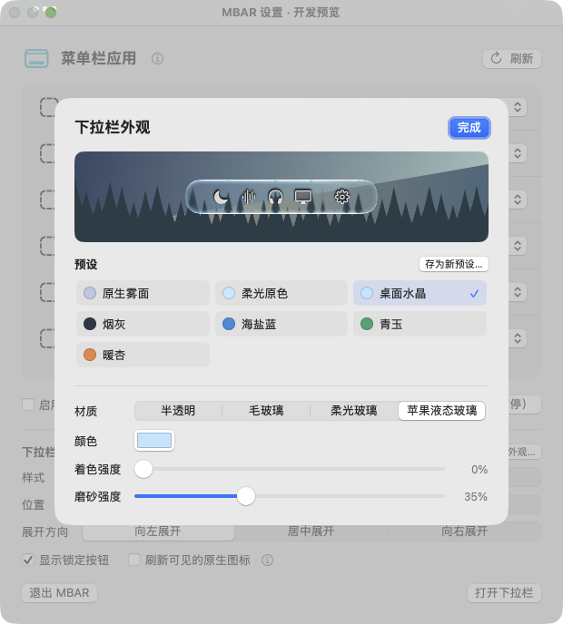

# MBAR 0.7.0

2026-11-20 · macOS 27 · Apple Silicon · build 19

[中文更新说明](#中文) · [Download DMG](https://github.com/QiushanHuang/MBAR/releases/download/v0.7.0/MBAR-0.7.0-macos-arm64.dmg) · [Download ZIP](https://github.com/QiushanHuang/MBAR/releases/download/v0.7.0/MBAR-0.7.0-macos-arm64.zip) · [SHA-256 checksums](https://github.com/QiushanHuang/MBAR/releases/download/v0.7.0/SHA256SUMS.txt)

## What’s new since 0.6.0

- **Glass with adjustable frosting.** Right-click the MBAR menu-bar entry and choose **下拉栏外观预设 → 桌面水晶** (Desktop Crystal). The new preset starts at 35% frosting and 0% tint. Fine detail softens through the center and bends at the rounded edges. Set frosting and tint to zero for a transparent center.
- **Seven presets and four materials.** Open **外观…** in Settings to adjust the tint, frosting for Apple Liquid Glass, or opacity for a translucent background. Soft Glass and Frosted Glass are also available. Save a named copy to keep a variation, or update one of your own presets. The appearance editor previews changes as you make them.
- **Grid, list or compact strip.** Open the shelf under its entry or dock it at either edge of the current display. Under the entry, choose leftward, centered or rightward expansion. Use Tab and the arrow keys to navigate, then Return or Space to open an item. The lock and settings buttons remain within reach while items scroll.
- **Optional live icons.** Turn on **刷新可见的原生图标** to refresh visible native menu items while the shelf is open. Manual artwork takes priority. Hidden items use their configured artwork, with a speed-text adapter for Clash Verge Rev when it exposes current readings through Accessibility. Closing the shelf stops sampling.

## Install or upgrade

Quit MBAR, then drag the app from the DMG into Applications or extract the ZIP and replace `/Applications/MBAR.app`. The arm64 build uses ad-hoc signing and is unnotarized. Existing categories and icon choices carry over. For rollback, keep the previous app, its preferences and its matching `~/Library/Application Support/MBAR/` folder.

After replacing the app, macOS may ask for Accessibility again. If **打开下拉栏** is disabled, use **打开辅助功能设置** to authorize MBAR and click **刷新**. If the old entry is already enabled, remove it, add the installed app again and restart MBAR. The glass effect needs no Screen Recording permission. Taking native icon snapshots or enabling live icon capture requires that permission.

Menu-bar hiding uses an experimental private macOS 27 interface. If system items disappear or the clock no longer opens Notification Center, choose **显示全部（暂停）** in Settings to restore icons and pause hiding. [Installation and troubleshooting](https://github.com/QiushanHuang/MBAR/blob/v0.7.0/README.md#install)

Debug and Release each passed 103 tests, with three opt-in live probes skipped in each suite. Separate macOS 27.0.1 window checks confirmed glass refraction, centered icons after material changes and softer fine detail at the default frosting level.

---

## 中文

**MBAR 0.7.0（构建号 19）**适用于 macOS 27 的 Apple Silicon Mac。[下载 DMG](https://github.com/QiushanHuang/MBAR/releases/download/v0.7.0/MBAR-0.7.0-macos-arm64.dmg) · [下载 ZIP](https://github.com/QiushanHuang/MBAR/releases/download/v0.7.0/MBAR-0.7.0-macos-arm64.zip) · [SHA-256 校验值](https://github.com/QiushanHuang/MBAR/releases/download/v0.7.0/SHA256SUMS.txt)

### 从 0.6.0 升级后可以做什么

- **使用带轻磨砂与边缘折射的液态玻璃。** 右键点击 MBAR 菜单栏入口，选择 **下拉栏外观预设 → 桌面水晶**。默认磨砂 35%、着色 0%，中央轻微柔化背景细节，圆角边缘可见折射。将磨砂和着色都调到 0%，中央完全通透。
- **定制外观。** 在设置的 **外观…** 里切换半透明、毛玻璃、柔光玻璃或苹果液态玻璃。七款内置预设均可调整颜色。半透明材质还可调背景不透明度，苹果液态玻璃可单独调磨砂。调整时直接预览，可以另存为个人预设，也可更新已有的个人预设。
- **改变布局和位置。** 图标条、带名称的网格和列表均支持在入口下方展开，或贴当前屏幕的左侧、右侧。在入口下方可选向左展开、居中或向右展开。按 Tab 进入，方向键移动，回车或空格打开项目；项目滚动时仍可使用锁定和设置按钮。
- **按需刷新原生图标。** 开启 **刷新可见的原生图标** 后，下拉栏打开时会更新系统菜单栏中可见的项目，关闭即停止采样。手选和导入的图标优先。隐藏项目沿用配置图标；Clash Verge Rev 通过辅助功能提供网速文字时，也可更新读数。

### 安装、权限与恢复

先退出 MBAR，再将 DMG 中的应用拖入「应用程序」，或解压 ZIP 并替换 `/Applications/MBAR.app`。发行包为 arm64，采用 ad-hoc 签名，未经 Apple 公证。升级会沿用分类和图标选择。如需回退，请保留旧应用、偏好和对应的 `~/Library/Application Support/MBAR/` 目录。

替换应用后，macOS 可能要求重新授予辅助功能权限。如果 **打开下拉栏** 按钮不可用，点击 **打开辅助功能设置** 授权，再回到 MBAR 点击 **刷新**。如果旧条目已开启但仍无权限，移除旧条目，重新添加安装后的 MBAR 并重启。玻璃外观无需录屏权限；读取原生快照或开启可见图标采集时才需要屏幕录制权限。

菜单栏隐藏仍使用 macOS 27 私有接口。如遇系统菜单项消失或点击时钟无法打开通知中心，可在设置点击 **显示全部（暂停）** 恢复。[安装与排障](https://github.com/QiushanHuang/MBAR/blob/v0.7.0/README.md#安装)

Debug 和 Release 各通过 103 项测试，各跳过 3 项需显式启用的实机探测。另在 macOS 27.0.1 的实际窗口上验证了玻璃边缘折射、切换材质后的图标居中，以及默认磨砂对背景细节的柔化效果。
