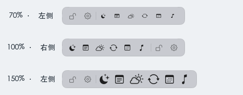

# MBAR 0.7.1

2026-11-20 · build 20 · macOS 27 · Apple Silicon

[DMG](https://github.com/QiushanHuang/MBAR/releases/download/v0.7.1/MBAR-0.7.1-macos-arm64.dmg) · [ZIP](https://github.com/QiushanHuang/MBAR/releases/download/v0.7.1/MBAR-0.7.1-macos-arm64.zip) · [SHA-256](https://github.com/QiushanHuang/MBAR/releases/download/v0.7.1/SHA256SUMS.txt) · [中文更新说明](#中文)

## Changes since 0.7.0

- **Adjust app icon size** in Settings → 下拉栏 → 图标大小, from 70% to 150%. Choose 还原 to return to 100%. New native captures retain their measured point dimensions. Older images without scale information use a proportionally fitted menu-sized fallback.
- **Place the lock and Settings together on either side** using 锁定与设置. The controls stay accessible while icons scroll. The shelf grows to fit tall artwork and preserves its aspect ratio and edge clearance.
- **Improved Apple clear glass contrast.** Single-ink symbols stay legible across light and dark backgrounds. Two-tone, color and manually selected original artwork retain their details with a narrow contour.

Quit MBAR and replace the copy in Applications using the DMG or ZIP. Existing preferences are retained. The download is ad-hoc signed and unnotarized. If macOS requests Accessibility again, authorize the installed app and click 刷新. [Install and troubleshoot](https://github.com/QiushanHuang/MBAR/blob/v0.7.1/README.md#install)

Debug and Release each passed 112 tests, with three opt-in probes skipped per configuration. Separate live checks confirmed that the 100% shelf sizes matched captured MBAR (14 × 9 pt) and LemonMonitor (64 × 20 pt) glyphs on the test Mac.

## 中文

- **图标大小**可在「设置 → 下拉栏」中调为 70%–150%，点「还原」回到 100%。新版原生快照保留实际点尺寸；缺少倍率信息的旧图片按比例适配。
- **锁定和设置按钮**可一起靠左或靠右。图标条、网格和列表均支持，滚动后仍可使用。图标放大时下拉栏同步增高，保留边缘留白。
- **苹果液态玻璃**上的单色图标在明暗背景交界处更清楚。双色、彩色和手选原图保留原色，轮廓沿图形边缘绘制。

升级时先退出 MBAR，再用 DMG 或 ZIP 中的应用替换「应用程序」中的旧版。原有设置会沿用。发行包采用 ad-hoc 签名，未经 Apple 公证。如果系统重新要求辅助功能权限，请为安装后的 MBAR 授权并点击「刷新」。[安装与排障](https://github.com/QiushanHuang/MBAR/blob/v0.7.1/README.md#安装)

Debug 和 Release 各通过 112 项测试，各跳过 3 项需显式启用的实机探测。另在本机核对了 MBAR 箭头与 LemonMonitor，在 100% 下分别按采集到的 14 × 9 点和 64 × 20 点显示。
